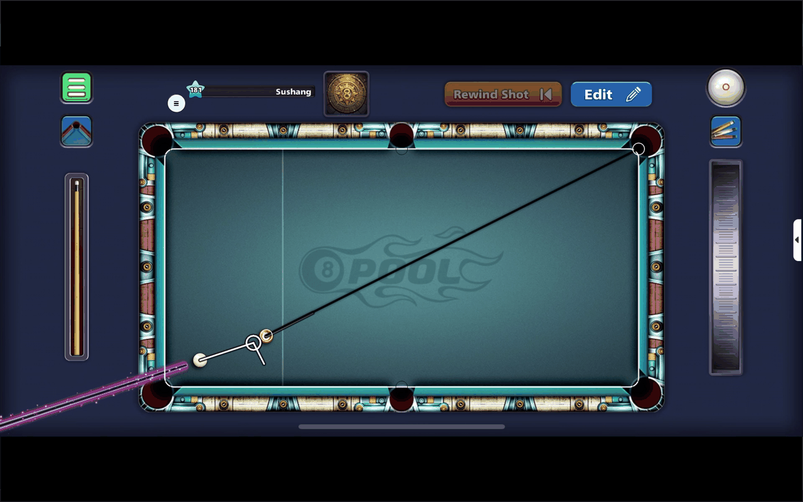

# Pool Aim

[](https://github.com/Sushang-Agnihotri/8-Ball-Pool-Aim-tool/actions/workflows/ci.yml)
[](LICENSE)


A minimal, transparent, always-on-top aiming overlay for pool and billiards, built with Python and PyQt5.
It draws direct aim lines, single/double bank shots and pocket lines on your screen.

**It is a passive overlay.** It does not read screen contents, inject into, hook, or modify any game or other
process, makes no network connections, and runs no subprocesses.

> **Fair-play notice:** Many online games forbid third-party aiming aids in their Terms of Service and may ban
> accounts that use them. Use this tool only for practice, offline play, or where it is allowed. You are
> responsible for how you use it.

| Aim line | Bank shot | Double bank | Settings |
|---|---|---|---|
|  |  |  |  |

## Features

- Borderless, translucent overlay that stays on top of the game window
- Grab-and-drop markers: click to pick up the cue/object ball markers, click again to drop
- Single and double bank trajectories, with a visual "snap" to a nearby pocket
- Hotkeys 1-6 send the last-moved ball to one of six pockets
- Toggle aim lines, bank shots and pocket lines; set line thickness, opacity and colour
- Resizable, movable table to fit any geometry
- Persistent, validated settings

## Install

Requires Python 3.9+.

```bash
git clone https://github.com/Sushang-Agnihotri/8-Ball-Pool-Aim-tool.git
cd 8-Ball-Pool-Aim-tool
python -m venv .venv
# Windows: .venv\Scripts\activate    macOS/Linux: source .venv/bin/activate
pip install -r requirements.txt
```

## Run

```bash
python aim.py          # or: python -m pool_aim  (after `pip install -e .`)
```

1. Drag/resize the overlay to match the on-screen table.
2. Press **Enter** to lock it when aligned (press again to unlock).

## Controls

| Action | Input |
|---|---|
| Move table (unlocked) | Drag inside the table |
| Resize table (unlocked) | Drag the white grips |
| Pick up / drop p1, p2 | Click the circle, move, click again |
| Menu | `O` or the menu button |
| Lock / unlock | `Enter` |
| Send last ball to pocket | `1`-`3` top row, `4`-`6` bottom row |
| Save / load settings | `Ctrl+S` / `Ctrl+L` |
| Cancel carry / quit | `Esc` (first cancels a carry, then closes) |

## Configuration

Settings are saved to a per-user config file, **not** the working directory:

| OS | Path |
|---|---|
| Windows | `%APPDATA%\pool-aim\config.json` |
| macOS | `~/Library/Application Support/pool-aim/config.json` |
| Linux | `$XDG_CONFIG_HOME/pool-aim/config.json` (default `~/.config/...`) |

Override with the `POOL_AIM_CONFIG` environment variable. The file is size-limited and every value is validated
on load; invalid values are ignored. Delete the file to reset to defaults. (Older versions used `pf_config.json`
next to the script; it is no longer read.)

## Development

```bash
pip install -e ".[dev]"
ruff check . && ruff format --check .
pytest
bandit -r src
pip-audit -r requirements.txt
```

Project layout: `src/pool_aim/geometry.py` (pure maths), `config.py` (safe persistence), `app.py` (Qt UI).
See [CONTRIBUTING.md](CONTRIBUTING.md) and [SECURITY.md](SECURITY.md).

## Troubleshooting

- **Overlay not on top:** toggle lock/unlock, or click the overlay to focus it.
- **`ModuleNotFoundError: PyQt5`:** activate your virtualenv and run `pip install -r requirements.txt`.
- **Odd settings:** delete the config file (see above).

## License

[MIT](LICENSE)
