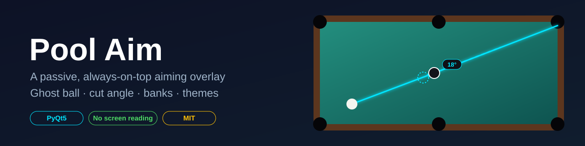
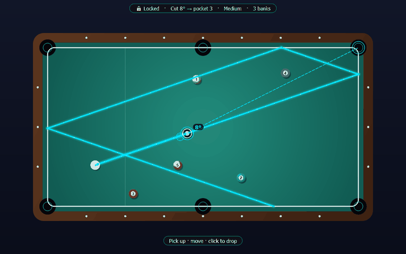
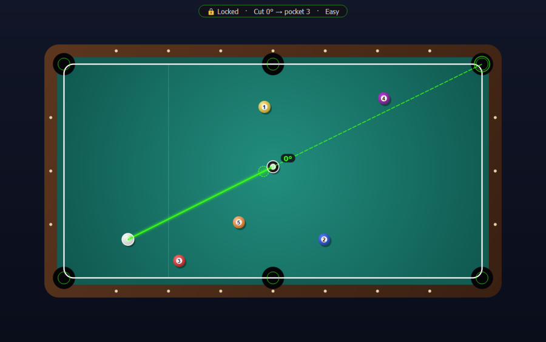
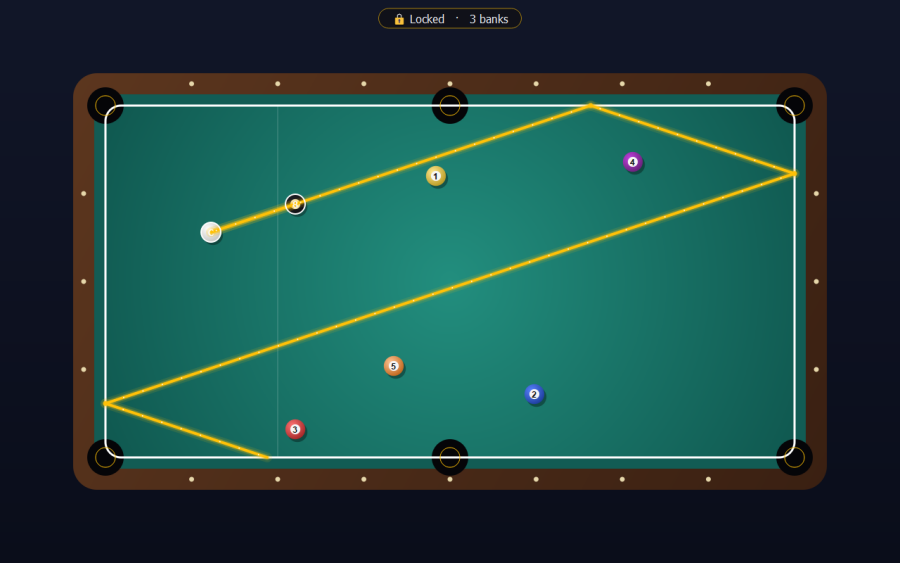
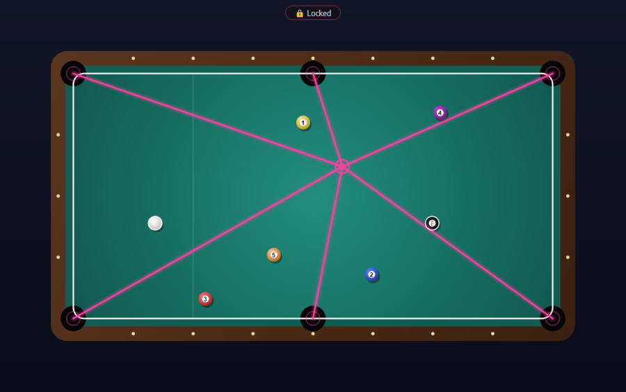
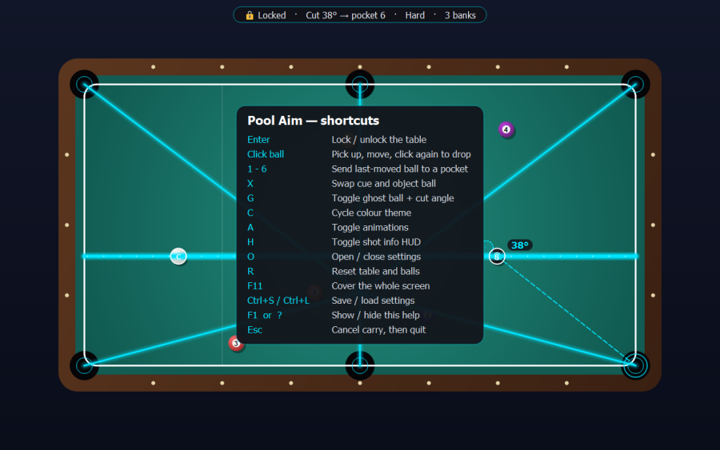
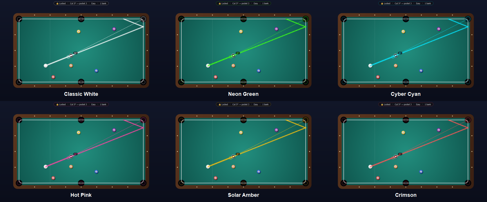
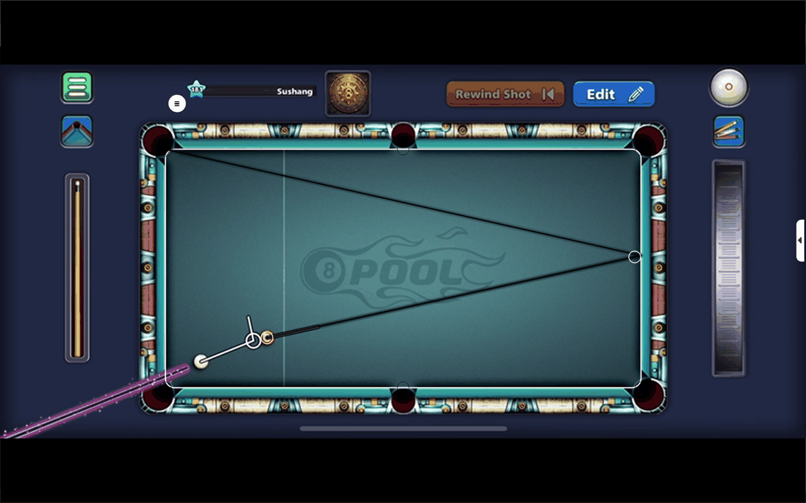
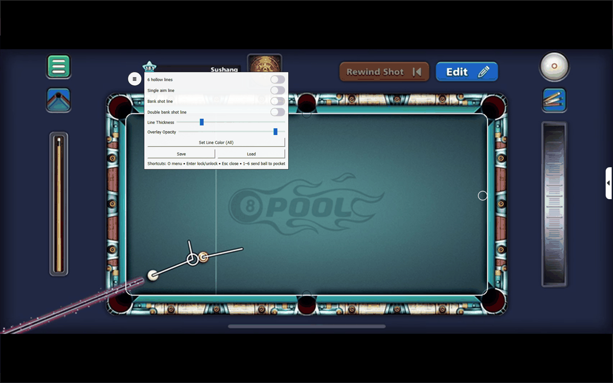
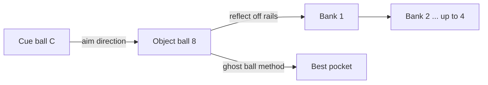

<div align="center">



[](https://github.com/Sushang-Agnihotri/8-Ball-Pool-Aim-tool/actions/workflows/ci.yml)
[](https://github.com/Sushang-Agnihotri/8-Ball-Pool-Aim-tool/actions/workflows/codeql.yml)
[](LICENSE)


**A minimal, transparent, always-on-top aiming overlay for pool and billiards.**
Direct aim lines · ghost ball · cut angle · single/double banks · pocket lines · 7 themes.



</div>

> **Fair-play notice:** many online games forbid third-party aiming aids in their Terms of Service and may ban
> accounts that use them. Use this tool only for practice, offline play, billiards training, or where it is
> allowed. You are responsible for how you use it.

**It is a passive overlay.** It does not read screen contents, inject into, hook, or modify any game or other
process, makes no network connections, and runs no subprocesses.

## Contents

[Features](#features) · [Gallery](#gallery) · [Install](#install) · [Quick start](#quick-start) · [Controls](#controls) ·
[How the maths works](#how-the-maths-works) · [Configuration](#configuration) · [FAQ](#faq) ·
[Development](#development) · [Roadmap](#roadmap)

## Features

| | |
|---|---|
| 🎯 **Aim line + banks** | Direct line, single bank and double bank (up to 4 rails) with rail-impact markers. |
| 👻 **Ghost ball + cut angle** *(new)* | Picks the easiest pocket for the object ball, draws the ghost-ball position and shows the cut angle. |
| 📊 **Shot HUD** *(new)* | Live readout: lock state, cut angle → pocket, difficulty (Easy → Very hard), bank count, "pocketed ✔". |
| 🎨 **7 colour themes** *(new)* | One-click palettes plus a custom colour picker. Press `C` to cycle. |
| ✨ **Animations** *(new)* | Light pulses flowing along the shot, pulsing pocket lock-on ring, animated ghost guide, toast notifications. |
| 🧲 **Snap to pockets** | Balls and shot endpoints softly lock on to a nearby pocket (with hysteresis so it does not flicker). |
| ✋ **Grab-and-drop** | Click a ball marker to pick it up, move, click again to drop. |
| ⌨️ **Keyboard first** | 1-6 send a ball to a pocket, `X` swap, `G` ghost, `H` HUD, `R` reset, `F1` help, `F11` cover screen. |
| 💾 **Safe settings** | Per-user, validated, atomically written config. Bad files can never break the overlay. |
| 🧪 **Tested & scanned** | Unit tests, ruff, bandit, pip-audit, CodeQL and Dependabot in CI. |

## Gallery

| Ghost ball + cut angle | Bank shot |
|---|---|
|  |  |
| **Double bank** | **Pocket lines** |
|  |  |
| **Settings panel** | **Built-in help (F1)** |
|  |  |

**Themes**



<sub>Screenshots are rendered over a synthetic table with `python tools/render_assets.py`, so they can be
regenerated after any visual change.</sub>

## In a real game

The overlay sitting on top of a live game window (earlier version, same idea):

| Aim line | Bank shot | Double bank | Settings |
|---|---|---|---|
|  |  |  |  |

## Install

Requires Python 3.9+.

```bash
git clone https://github.com/Sushang-Agnihotri/8-Ball-Pool-Aim-tool.git
cd 8-Ball-Pool-Aim-tool
python -m venv .venv
# Windows: .venv\Scripts\activate    macOS/Linux: source .venv/bin/activate
pip install -r requirements.txt
```

Prefer a double-clickable app? Tagged releases attach a `PoolAim.exe` for Windows (built by CI with PyInstaller).

## Quick start

```bash
python aim.py                 # or: python -m pool_aim  /  pool-aim  (after `pip install -e .`)
python aim.py --fullscreen    # overlay covers the whole screen
python aim.py --no-animation  # lighter on old machines
python aim.py --reset-config  # ignore the saved settings for this run
```

1. Drag the table and its white grips so the outline matches the real table's playing area.
2. Put **C** (cue ball marker) and **8** (object ball marker) on top of your balls.
3. Read the lines and the HUD. Press **Enter** to lock the table once aligned.
4. Press **F1** any time for the shortcut list.

## Controls

| Action | Input |
|---|---|
| Move table (unlocked) | Drag inside the table |
| Resize table (unlocked) | Drag the white grips |
| Pick up / drop cue (C) or object (8) ball | Click it, move, click again |
| Lock / unlock | `Enter` |
| Send last-moved ball to a pocket | `1`-`3` top row, `4`-`6` bottom row |
| Swap cue and object ball | `X` |
| Toggle ghost ball + cut angle / HUD / animations | `G` / `H` / `A` |
| Cycle colour theme | `C` |
| Reset table and balls | `R` |
| Settings menu | `O` or the ☰ button |
| Cover the whole screen | `F11` |
| Save / load settings | `Ctrl+S` / `Ctrl+L` |
| Help overlay | `F1` or `?` |
| Cancel carry / close help / quit | `Esc` |

## How the maths works



- **Banks:** the ray from the object ball is reflected off the four rails of your table rectangle (angle in = angle
  out), up to four times. If the last leg ends near a pocket it locks on.
- **Ghost ball:** to send the object ball to a pocket, the cue ball must arrive exactly two ball radii behind it on
  the pocket-to-object line. That point is drawn as the dotted ghost ball.
- **Cut angle:** the angle between *cue → object* and *object → pocket*. 0° is straight in; pockets needing more than
  80° are ignored.
- **Difficulty:** a rough score from cut angle (70%) and travel distance (30%).

All of it lives in the pure, unit-tested [`geometry.py`](src/pool_aim/geometry.py).

## Configuration

Settings are saved to a per-user config file, **not** the working directory:

| OS | Path |
|---|---|
| Windows | `%APPDATA%\pool-aim\config.json` |
| macOS | `~/Library/Application Support/pool-aim/config.json` |
| Linux | `$XDG_CONFIG_HOME/pool-aim/config.json` (default `~/.config/...`) |

Override with the `POOL_AIM_CONFIG` environment variable. The file is size-limited and every value is validated
on load; invalid values are ignored. Delete the file to reset to defaults.

## FAQ

**Is this a cheat / will I get banned?** It is a passive drawing overlay, but that does not change a game's rules.
Many online games ban aiming aids. Use it for practice, training and offline play.

**Does it read my screen or the game?** No. It only draws. You line it up by eye.

**Why is the overlay not on top?** Toggle lock/unlock or click it. Some exclusive-fullscreen games hide all
overlays; use borderless/windowed mode.

**It looks tiny/huge on my 4K display.** High-DPI scaling is on by default. Resize the table with the grips and
save with `Ctrl+S`.

**Can I use my own colours?** Yes, the `…` swatch in the menu opens a colour picker.

**`ModuleNotFoundError: PyQt5`** Activate your virtualenv and `pip install -r requirements.txt`.

## Development

```bash
pip install -e ".[dev]"
ruff check . && ruff format --check .
QT_QPA_PLATFORM=offscreen pytest      # PowerShell: $env:QT_QPA_PLATFORM="offscreen"; pytest
bandit -r src
pip-audit -r requirements.txt
python tools/render_assets.py         # regenerate docs/images (needs Pillow: pip install -e ".[assets]")
```

Project layout: `geometry.py` (pure maths), `config.py` (safe persistence), `themes.py`, `app.py` (Qt UI),
`tools/` (asset renderer). See [CONTRIBUTING.md](CONTRIBUTING.md), [SECURITY.md](SECURITY.md) and
[CHANGELOG.md](CHANGELOG.md).

## Roadmap

- [x] Ghost ball, cut angle, difficulty HUD
- [x] Themes, animations, help overlay
- [ ] Multiple saved profiles (per game / per screen)
- [ ] Click-through mode while locked
- [ ] Spin / English visualisation
- [ ] Pre-built macOS and Linux bundles

Ideas welcome via [issues](https://github.com/Sushang-Agnihotri/8-Ball-Pool-Aim-tool/issues). If the project helps
you, a ⭐ makes my day.

## License

[MIT](LICENSE)
